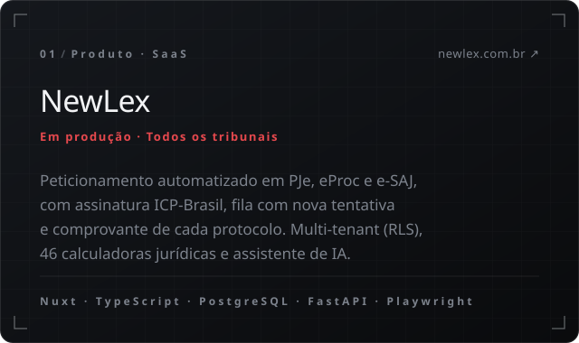
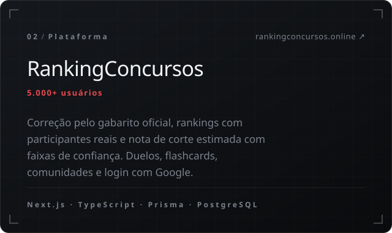
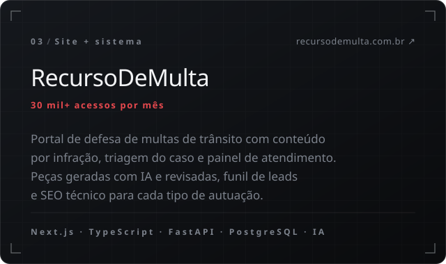
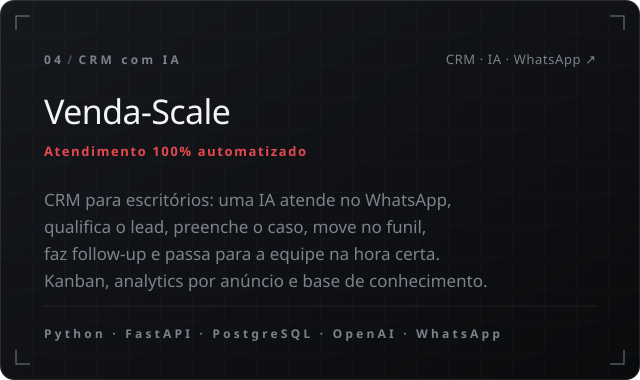
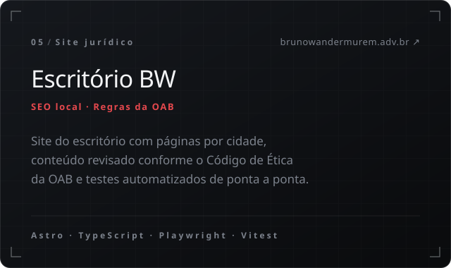
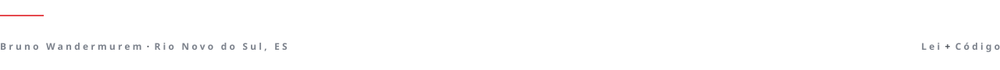

<a href="https://www.linkedin.com/in/brunowandermuremadv"></a>

<p align="center">
<a href="https://www.linkedin.com/in/brunowandermuremadv"></a>
<a href="https://newlex.com.br"></a>
<a href="https://recursodemulta.com.br"></a>
<a href="https://rankingconcursos.online"></a>
<a href="https://brunowandermurem.adv.br"></a>
<a href="mailto:brunowandermurem.juris@gmail.com"></a>
</p>

<br/>

### `// sobre`

Advogado criminalista e de Direito Digital que também escreve o código. Trabalho na fronteira entre o jurídico e a engenharia: traduzo exigência legal em decisão técnica e construo software que resolve problemas reais da advocacia.

```text
formação    Pós em Direito Penal e Processo Penal · Pós em Direito Digital e LGPD
            Análise e Desenvolvimento de Sistemas (em curso)
produto     NewLex — 1.000+ peticionamentos/mês, escritórios de volume em São Paulo
plataforma  RankingConcursos — 5.000+ usuários
portal      RecursoDeMulta — 30 mil+ acessos/mês
crm         Venda-Scale — atendimento de leads 100% automatizado com IA
foco        proteção de dados · prova digital · segurança · governança de IA
```

<br/>

### `// projetos`

<p align="center">
<a href="https://newlex.com.br"></a>
<a href="https://rankingconcursos.online"></a>
<a href="https://recursodemulta.com.br"></a>

<a href="https://brunowandermurem.adv.br"></a>
<a href="https://www.linkedin.com/in/brunowandermuremadv"></a>
</p>

<sub>A maior parte do código está em repositórios privados de clientes e produtos. A atividade aparece no gráfico de contribuições abaixo, e os projetos podem ser apresentados em entrevista.</sub>

<br/>

### `// stack`

<p>


</p>

<br/>

<details>
<summary><code>// english</code></summary>
<br/>

Brazilian attorney (Criminal & Digital Law) and software developer. Founder and developer of **NewLex**, a legaltech that automates electronic court filing across Brazil's PJe, eProc and e-SAJ systems (1,000+ filings a month for high-volume law firms in São Paulo); **RankingConcursos**, a public-exam ranking platform with 5,000+ users; **RecursoDeMulta**, a traffic-fine defense site and system with 30,000+ monthly visits; and **Venda-Scale**, an AI-driven CRM that runs law-firm lead intake on WhatsApp end to end. Postgraduate degrees in Criminal Law & Procedure and in Digital Law & Data Protection. Focus on data protection (LGPD/GDPR), digital evidence, compliance and AI governance. Open to remote roles.

</details>

<br/>


